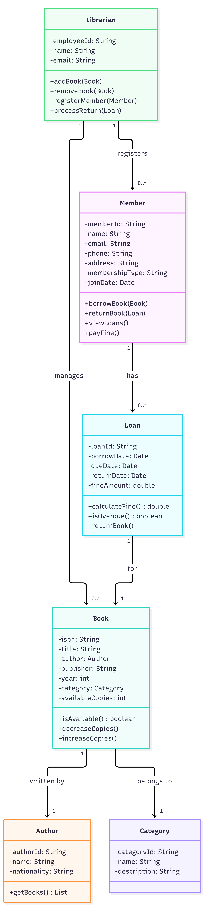

# Public Library Lending Management System

## Overview

This project implements a Public Library Lending Management System based on an object-oriented design. The system models the core entities involved in library operations, including members, books, loans, authors, categories, and librarians.

The implementation demonstrates the relationships and behaviors defined in the accompanying class diagram, including book borrowing, returning, loan tracking, and basic catalog management.

## Class Diagram

The system design is represented by the following UML class diagram:



## System Components

- **Librarian**: Manages the book catalog and registers library members.
- **Member**: Borrows and returns books, views active loans, and handles fines.
- **Loan**: Represents a borrowing transaction with due dates and fine calculation.
- **Book**: Tracks availability, bibliographic details, and associated author and category.
- **Author**: Represents the writer of one or more books.
- **Category**: Classifies books into subject areas.

## Relationships

- A Librarian manages multiple Books and registers multiple Members.
- A Member has zero or more Loans.
- Each Loan is associated with exactly one Book.
- A Book is written by one Author and belongs to one Category.

## Project Structure

```
public-library-system/
├── library_system.py      # Complete implementation of all classes and demonstration
├── class-diagram.png      # UML class diagram
├── README.md              # This documentation
└── requirements.txt       # Dependencies (none required beyond Python standard library)
```

## Requirements

- Python 3.8 or higher

## How to Run

1. Clone or download this repository.
2. Navigate to the project directory.
3. Execute the following command:

```bash
python library_system.py
```

The program will run a demonstration that creates sample objects, registers a member, processes a book loan, and handles the return.

## Sample Execution Output

```
============================================================
PUBLIC LIBRARY MANAGEMENT SYSTEM - DEMO
============================================================
Librarian Sarah Johnson added book: 1984
Member 'Michael Delight Simon' registered successfully.

----------------------------------------
BORROWING PROCESS
----------------------------------------
Michael Delight Simon successfully borrowed '1984'.

Loans for Michael Delight Simon:
  - Loan LN-0001: 1984 | Active | Due: 2026-12-07

Book availability after borrowing: 2 copies left

----------------------------------------
RETURNING PROCESS
----------------------------------------
Michael Delight Simon returned '1984'. Fine: $0.00

Loans for Michael Delight Simon:
  - Loan LN-0001: 1984 | Returned | Due: 2026-12-07

============================================================
DEMO COMPLETED SUCCESSFULLY
============================================================
```

## Author

**Michael Delight Simon**    
Information System Engineering  
Near East University

---

*This implementation was developed to demonstrate the mapping of a UML class diagram into executable Python code for academic purposes.*


[def]: class-diagram.png